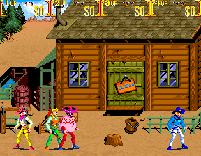

# Sunset Riders Recomp

A Windows port and recompilation research project for **Sunset Riders, 4 Players ver EAC**. The aim is to make the arcade game playable on PC with four local input slots, a useful game menu and, eventually, four-player rollback online play.

The local game is already playable. A tester reports reaching the final-boss encounter with stable sound, working deaths and continues. On 14 November 2026 the tester also confirmed that all four physical controllers work with the cheats enabled. That is encouraging gameplay feedback, not a claim that every build, controller combination or ending has been verified.

**Local play, and now experimental online play.** Up to four players on up to four PCs can play with rollback, joining and leaving during the match. It has been checked on one PC (several windows and headless players, every state compared) and by a tester with four windows and real controllers; a match across the Internet between separate PCs is the next check. See the [roadmap](docs/roadmap.md) and [development status](docs/development-status.md).

## See it running




These captures come from the EAC laboratory build. The four-player scene uses scripted inputs; it does not demonstrate four physical controllers or an Internet match. The original artwork belongs to Konami. [Capture provenance](docs/evidence/screenshots.json) records how these images were made.

## How the game is put together

Your separately supplied ROM ZIP provides the original program, graphics and sound data. A Python loader checks the required members against their sizes, CRC32 and SHA-1 values, then assembles the board's memory regions **in RAM**. It does not rewrite or extract files into your ROM archive.

The native executable brings those regions together with a Motorola 68000 core for the main program, a Z80 core for the sound program, Konami video and PCM device support, and ymfm's YM2151 FM synthesis. The project supplies the board wiring, timing, input handling, checkpoints and local gameplay features. SDL3 supplies the PC window, audio output and controllers; the shared menu comes from recomp-common, with local adaptations.

**The current CPU cores interpret the original instructions.** Compiling this repository produces a native Windows executable, but does not yet statically translate the entire game into native PC instructions. Full static recompilation remains a research goal. [Architecture and component map](docs/architecture.md) explains the individual parts and their source locations.

## Build and play

You need Windows, the MSYS2 **UCRT64** development environment, GCC with C++20 support, CMake 3.24 or newer, Ninja, SDL3's development package and native Windows Python 3.10 or newer. The CPU/chip source subset needed by this export is already included under `third_party/`; the game ROMs are not.

From the UCRT64 terminal, clone the repository and build it:

```sh
git clone https://github.com/sunkpoet-lang/SUNSET-RIDERS-RECOMP.git
cd SUNSET-RIDERS-RECOMP
cmake -S . -B build-clean -G Ninja -DCMAKE_BUILD_TYPE=Release
cmake --build build-clean --parallel 2
ctest --test-dir build-clean --output-on-failure
python tools/run.py --rom "C:/my-roms/ssriders.zip" --exe "build-clean/Sunset-Riders-Lab.exe"
```

The last command opens the game through the verified loader. For dependencies, ROM requirements, build output and troubleshooting, read the [build guide](docs/build.md). You do not need MAME, FBNeo or a network service installed to build this local runtime.

## Playing locally

| Player | Move | Fire / jump | Coin |
| --- | --- | --- | --- |
| 1 | Arrow keys | Z / X | 1 |
| 2 | W A S D | F / G | 2 |
| 3 | I J K L | U / O | 3 |
| 4 | Numpad 4 / 6 / 8 / 5 | Numpad 1 / 3 | 4 |

Esc opens the shared menu, F10 opens the top bar and F11 switches fullscreen. Volume, offline turbo, lives and powerup options are available in the prototype. The tester has confirmed the menu and cheats in gameplay. F5/F8 currently use **one temporary in-memory save/load slot**, which is lost on exit; persistent external save-state loading is not implemented by this export.

## Playing online (experimental)

Build as above; `Sunset-Riders-Online.exe` is built beside the local executable. The host opens a room and the others join it, by the host's address and port (open or forward that UDP port on the host's network for players outside it):

```sh
python tools/run.py --rom "C:/my-roms/ssriders.zip" --exe "build-clean/Sunset-Riders-Online.exe" -- --host 7845 --late --name Host
python tools/run.py --rom "C:/my-roms/ssriders.zip" --exe "build-clean/Sunset-Riders-Online.exe" -- --join 203.0.113.5:7845 --name Guest
```

- `--players N` is the room's size (2-4, default 4); `--start N` begins once N players are seated (every PC must use the same value); `--late` lets players join and leave during the match (host).
- `--locals 2` puts two players on one PC (keyboard layouts P1 and P2, or two gamepads). Each PC takes the next free seats: the host is P1, the first PC to join P2, and so on.
- Every PC uses the keys of its own first players: arrows, Z/X and coin **1**, then WASD, F/G and coin **2**. In the four-player EAC set a coin brings a player in.
- Each player's name is shown under that player's score. Esc opens the menu; online, states, cheats, turbo and pause are off for everyone and the game runs on.
- Every PC needs the same build and the same verified ROM set; a different one is refused.

Every PC saves a replay of the whole match when it ends (a minute or more), in `replays` beside the program (`--replays FOLDER`, or `--replays none`). It holds the confirmed inputs of all four seats from the first frame, even across players joining and leaving, and a checksum every 60 frames. Watch one with:

```sh
python tools/run.py --rom "C:/my-roms/ssriders.zip" --exe "build-clean/Sunset-Riders-Online.exe" -- --replay "build-clean/replays/2026-11-16_20-14-27_ssriders_Host-Guest.fareplay"
```

It plays in the window (Esc quits) and says where it stops matching, if it does; `--headless` only checks it. A replay of another ROM set, or made with another version of the game's emulation, is refused.

`python tools/online_check.py --rom "C:/my-roms/ssriders.zip"` runs the online checks on one PC: the faster CPU loop against the original one, with and without rollbacks; four headless PCs joining and leaving; and hidden online windows with four seats.

## What is ready, and what remains

- **Local runtime:** standalone source build, sound/video, four input slots, menu, offline assists and temporary own-session save/load. Exported source validation recorded nine ROM-free tests and game-derived regression checks.
- **Human gameplay:** reported progress to the final-boss encounter with stable sound, deaths and continues. All four physical controllers with cheats enabled were subsequently confirmed by the tester. Final victory, online play and long sessions on other PCs still need acceptance.
- **Online (experimental):** rollback for up to four players on up to four PCs, one or two players per PC, joining and leaving during the match, names on screen and the menu's online restrictions. Checked on one PC and by a tester with four windows; a match across the Internet between separate PCs, online replays and spectators remain (see the [roadmap](docs/roadmap.md)).

A fresh HTTPS clone of the published revision was built from source on 14 November 2026: all nine ROM-free tests and the 1500-frame user-ROM regression passed. No laboratory objects were reused. See the [reproducibility receipt](docs/evidence/reproducibility-20261114.json). This demonstrates a functional source build with the recorded toolchain, not byte-identical binaries across different toolchains.

The [development notes](docs/development-status.md) distinguish repository features, laboratory evidence and reported human testing. The [source manifest](docs/source-manifest.json) identifies the r51 export; it is not a claim that later laboratory work is already included here.

## Credits and references

This work depends on the authors of **MAME**, **ymfm**, **SDL3**, **GekkoNet**, **recomp-common** and **arcade-decomp**, and on research from **tmntarcade-decomp**. Their roles, source references and licence notices are explained in [CREDITS.md](CREDITS.md) and [THIRD_PARTY_NOTICES.md](THIRD_PARTY_NOTICES.md).

Sunset Riders is a Konami game. This independent project is not affiliated with or endorsed by Konami or those upstream projects. No ROMs, BIOS data, extracted game program, save-state payloads or rights to the original artwork are supplied.
