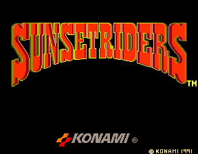

# Sunset Riders Recomp

Experimental Sunset Riders PC port and recompilation research.

**Current implementation:** a native Windows application interpreting the 68000 and Z80 guest CPUs. Full static recompilation is a future goal, not a completed feature. This is a local laboratory prototype, not a finished release.

## Demonstration

Captured from our local prototype using the original **4 Players ver EAC** set. The second image is a scripted four-player scene; it is not evidence of four physical controllers or internet play. These screenshots illustrate the original game, whose artwork belongs to its respective rights holders. They are not project logos or freely licensed game assets. See [capture provenance](docs/evidence/screenshots.json).

## Status

| Area | Evidence and limitations |
| --- | --- |
| Game runtime | Title/attract and scripted first-stage four-player activity; full-game completion not validated |
| CPU execution | Interpreted 68000 and Z80; full static recompilation pending |
| Sound and video | Local SDL3 window/audio; repeatable diagnostic state, image and audio checks |
| Four-player input | Four input slots and SDL virtual-controller tests; physical P1 confirmed by the tester, P2-P4 physical acceptance pending |
| Menu | Shared recomp-common top bar and overlay, volume, fullscreen and temporary own-session save/load |
| Turbo fire | Per-player offline prototype; tester confirmed turbo during gameplay, four-slot live virtual-input checks passed |
| Cheats | Offline lives and native rapid/double powerup prototype; per-player local checks passed, human lifecycle acceptance pending; invulnerability not implemented |
| Online | Four-player online not implemented |
| Session duration | r51 candidate removes the five-minute stop; eight-minute headless soak passed; provisional twelve-hour profile not fully exercised |
| Builds | Standalone Windows source build and nine ROM-free checks passed; no public binary release |

The project uses OpenSpec to specify changes before implementation. Test repeatability does not establish cycle accuracy or equivalence to a complete MAME run. Source inventory and retained licence notices are included in [THIRD_PARTY_NOTICES.md](THIRD_PARTY_NOTICES.md).

## ROMs and saves

No ROMs, BIOS files, decrypted game code or save-state payloads are supplied. The prototype reads a user-provided, verified ROM archive without modifying it. Build and launch instructions are in [docs/build.md](docs/build.md); use your own separately supplied EAC archive.

F5/F8 currently use one temporary in-memory slot, lost on exit. Public loading of external state files remains gated. Local assists are designed to be disabled in protected online modes; real online transport and clean-session admission are separate unfinished work.

## Credits

Built upon research and software from MAME, ymfm, SDL3, recomp-common and the arcade-decomp/TMNT projects. See [CREDITS.md](CREDITS.md) and [THIRD_PARTY_NOTICES.md](THIRD_PARTY_NOTICES.md) for upstream projects, pins and retained licences.

Sunset Riders is a Konami game. This independent project is not affiliated with or endorsed by Konami or the upstream projects.

Extended-session evidence: [r51 local test summary](docs/evidence/session-r51.json). Human sustained audio and full-level acceptance remain pending.

Standalone export validation: [build and regression evidence](docs/evidence/source-export.json). The source build reproduced the accepted r51 frame, canonical counters and audio digests, with exact temporary save/load and zero audio queue resets.
